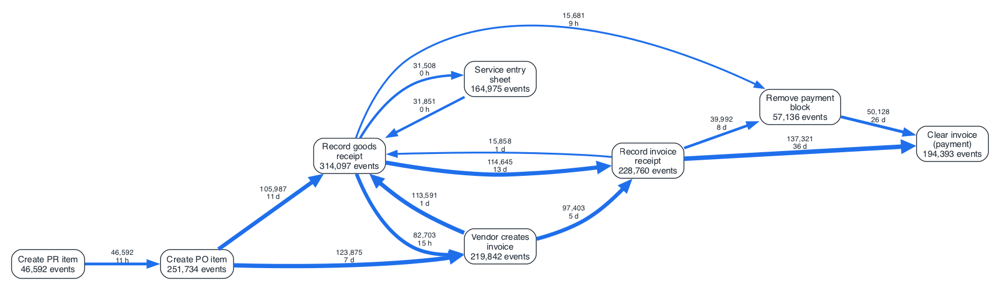
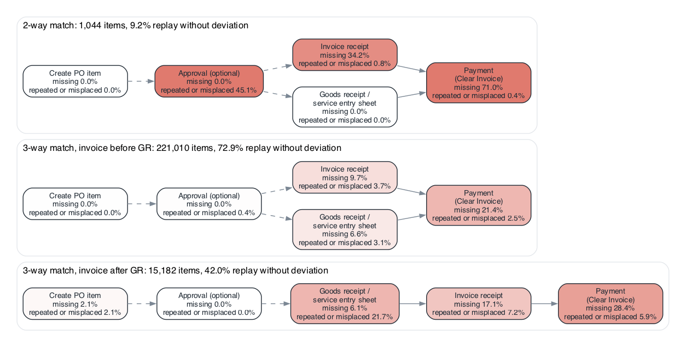
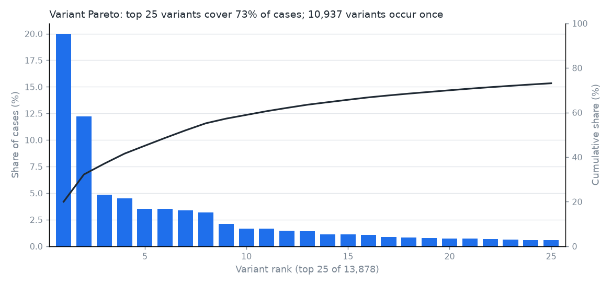
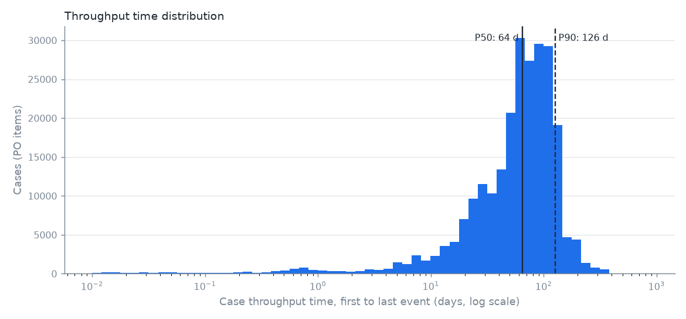

# process-mining-audit

Process mining and control testing on a purchase-to-pay (P2P) event log, written the way I would
approach it in an internal audit: discover the process, check it against a normative model, then
test controls on every item instead of a sample. The data is the public BPI Challenge 2019 log
(251,734 purchase order items, 1.6 million events).

```
pm-audit fetch | discover | conformance | controls | report
```

The audit-style output is [`reports/p2p_process_audit.md`](reports/p2p_process_audit.md): findings
with population counts, examples, risk, recommendation and root-cause slices. Every number below
comes from that run.

## Why I built this

I work on data analytics in internal audit. The data I use at work cannot be published, and a
portfolio piece that shows only screenshots does not tell anyone how the tests were designed. This
repository is the same kind of work on a public log, with the code and the decisions in the open.

Process mining suits audit because the log records what the ERP did for every item. A walkthrough
follows a few documents through the process as the owner describes it. With the log I can count
exceptions across the whole population, test sequence and timing (invoice before receipt, payment
before invoice), and re-run the same tests next period.

## What it does

| Step | What | Where |
|---|---|---|
| Discovery | Variants, throughput time, directly-follows map with frequency and median wait per edge, inductive miner tree | `discovery.py`, `figures.py` |
| Conformance | One normative process tree per item category, token replay on all variants, alignments on the 500 most frequent projected variants | `conformance.py` |
| Controls | 14 tests, each run only on the item categories where it applies, with population, flagged count, examples and the risk it addresses | `controls.py` |
| Slices | Three largest contributors to each finding by company, vendor and spend area | `controls.slice_rates` |

### Item categories as the baseline

BPI 2019 puts every item into one of four categories, and they have different control designs.
Running every test on every item gives answers that look like findings and are not. The counts:

| Category | Items | What it means for testing |
|---|---|---|
| 3-way match, invoice before GR | 221,010 | Receipt required, invoice may be booked first by configuration |
| 3-way match, invoice after GR | 15,182 | Invoice verification is GR-based; invoice before receipt is a bypass |
| Consignment | 14,498 | Settled on withdrawal; no invoice or payment chain in the log |
| 2-way match | 1,044 | No receipt expected |

Receipt tests run on the two 3-way categories, invoice and payment tests on the three categories that
have invoices, and approval, change and segregation tests on all of them (receipt versus invoice
only on the 3-way categories). The scope table is in the report.

### Late payment without payment terms

The log has no payment terms. A flat 60-day limit would treat a vendor on 14-day terms and one on
90-day terms alike, so I use the vendor's own behaviour as the reference. For each item the proxy is
the median invoice-to-payment time of its vendor over all of that vendor's paid items. Vendors with
fewer than 30 paid items use their company's median. An item is flagged when it is paid more than 14
days after that median, which is roughly one payment-run cycle. The 14 days is a judgement call, so
the report shows the rate at 0, 7, 14, 30 and 60 days.

471 vendors have their own proxy (175,300 items); 7,969 items use the company median. Proxies run from
17 days (P10) through 42 (median) to 92 (P90). A vendor that is always paid late gets a late proxy,
so this finds departures from usual behaviour, not breaches of contract.

### Segregation of duties: people and batch jobs

Resources `NONE` and `batch_*` post documents under shared ids. The headline SoD rates count named users
only. The all-user figures are reported next to them. In this log the system users add nothing to the
flagged counts: the same-user flags are the same with or without them, they only widen the tested
population (4,378 instead of 4,200 for create and approve).

## Results (BPI Challenge 2019, full log)

| Measure | Result |
|---|---|
| Cases / events | 251,734 purchase order items / 1,595,828 events |
| Variants | 13,878; top 10 cover 58.9%, 48 are needed for 80%; 78.8% of variants occur once |
| Throughput | median 64 days, P90 126, P95 142 |

Conformance, each category against its own model:

| Category | Items | Replay without deviation | Alignment fitness |
|---|---|---|---|
| 3-way, invoice after GR | 15,182 | 6,376 (42.0%) | 0.850 (76.7% of items aligned) |
| 3-way, invoice before GR | 221,010 | 161,226 (72.9%) | 0.922 (99.9%) |
| 2-way | 1,044 | 96 (9.2%) | 0.659 (100%) |

Consignment is not modelled. Across the three modelled categories 167,698 of 237,236 items (70.7%)
replay without deviation.

Control tests (flagged / tested):

| Control | Applies to | Flagged / tested | Rate |
|---|---|---|---|
| C1a Invoice before goods receipt | 3-way after GR | 0 / 11,128 | 0.0% |
| C1b Invoice without any receipt | 3-way after GR | 0 / 11,128 | 0.0% |
| C1e Invoice before goods receipt (allowed by configuration, for scale) | 3-way before GR | 16,356 / 199,242 | 8.2% |
| C1f Payment without any receipt | 3-way before GR | 565 / 173,698 | 0.3% |
| C1c Payment before invoice receipt | all invoiced | 24 / 183,293 | 0.01% |
| C1d Payment without any invoice receipt | all invoiced | 384 / 183,677 | 0.2% |
| C2 PO created on a later day than the invoice | all invoiced | 3,621 / 211,391 | 1.7% |
| C3a Same user creates and approves the PO | all | 1,972 / 4,200 | 47.0% |
| C3b Same user creates the PO and clears the invoice | all | 0 / 164,837 | 0.0% |
| C3c Same user records receipt and invoice | 3-way | 0 / 171,829 | 0.0% |
| C4a Price or quantity changed after approval | all | 917 / 4,378 | 20.9% |
| C4b Price or quantity changed after goods receipt | all | 5,768 / 234,480 | 2.5% |
| C5 Paid later than the vendor's usual days-to-pay plus 14 days | all invoiced | 30,792 / 183,269 | 16.8% |
| C6 Approval outside 07:00 to 19:00 or on a weekend | all | 192 / 4,378 | 4.4% |

What the root-cause slices show:

- Maverick buying is concentrated. Company 0003 (2-way match items) has 605 of its 687 tested items
  ordered after the invoice (88.1%), and vendor 0550 alone accounts for 1,215 of the 3,621 flags (33.6%,
  96.4% of that vendor's items).
- Changes after approval sit with one vendor: vendor 0197 has 694 of the 917 flags (75.7%, 80.0% of its
  approved items), and the Trading & End Products spend area has 742 (80.9%).
- Payments without an invoice or receipt trace mostly to vendor 0246 (232 of 384 and 232 of 565).
- Late payment is not concentrated. The largest vendor holds 6.2% of the flags, so it looks like a
  general payment-run pattern and not a few problem suppliers.
- Self-approval is common in the small approved population: vendors 0127 and 1317 are at 100%.
- The GR-based control holds: no invoice before receipt and no invoice without a receipt on the
  tested items.

### Figures

Process map of the eight core activities. Nodes show event counts, edges show occurrences and the
median time between the two events.



Conformance deviation view, one normative model per item category. Shading shows the larger of the
missing share and the repeated or misplaced share of aligned items at each step.






## Quickstart

```bash
brew install graphviz   # the dot binary, needed only for the process maps
python3.12 -m venv .venv && source .venv/bin/activate
pip install -e ".[dev]"
pm-audit fetch          # downloads the log into data/ (gitignored, about 0.5 to 0.7 GB)
pm-audit report --refresh   # discovery, conformance, controls; writes reports/ and docs/
pytest -q && ruff check . && ruff format --check .
```

Each stage also runs alone (`pm-audit discover`, `conformance`, `controls`). `--sample N` runs on a
seeded random sample of N whole cases. The tests use a small hand-made event log and need neither the
download nor Graphviz.

## Data and license

- Dataset: van Dongen, B.F. (Boudewijn). BPI Challenge 2019. 4TU.ResearchData.
  doi:[10.4121/uuid:d06aff4b-79f0-45e6-8ec8-e19730c248f1](https://doi.org/10.4121/uuid:d06aff4b-79f0-45e6-8ec8-e19730c248f1)
  (landing page: https://data.4tu.nl/articles/_/12715853/1). License: CC BY 4.0. The data is not
  redistributed here; it is downloaded on demand.
- Official file: `https://ndownloader.figshare.com/files/24072995` (728,558,522 bytes, MD5
  `4eb909242351193a61e1c15b9c3cc814`).
- Mirror note: when I ran this (2026-10-28) that URL returned HTTP 504 and data.4tu.nl was not
  reachable. The results use the challenge's original CSV release (1,595,923 events, the same count as
  the official log) from a public GitHub mirror. `pm-audit fetch` tries the official URL first and falls
  back to the mirror. I could not compare the mirror file's checksum with 4TU's.
- 95 events with the placeholder date 1948-01-26 are excluded; no subsampling is applied.

## Limitations

- There are no payment terms and no vendor master data in the log. Late payment therefore uses the
  empirical proxy above, and a test for the same user creating a vendor and paying it cannot be run.
- There is no explicit approval event. `Change Approval for Purchase Order` and `Release Purchase
  Order` are the closest and exist for only a few percent of items, so the approval tests cover a small
  population.
- Amounts in the log are cumulative net worth, not invoice values, so the tests count items, not money.
- `Record Service Entry Sheet` is always posted under a system user, so the receipt-side segregation
  test covers goods receipts only.
- Items still open when the log ends (April 2020) appear as missing steps in the conformance results.
- Flags are exceptions to follow up, not proof of error or fraud.

---

Utku Fidan, internal audit data analytics lead. [utkufidan.com](https://utkufidan.com)
